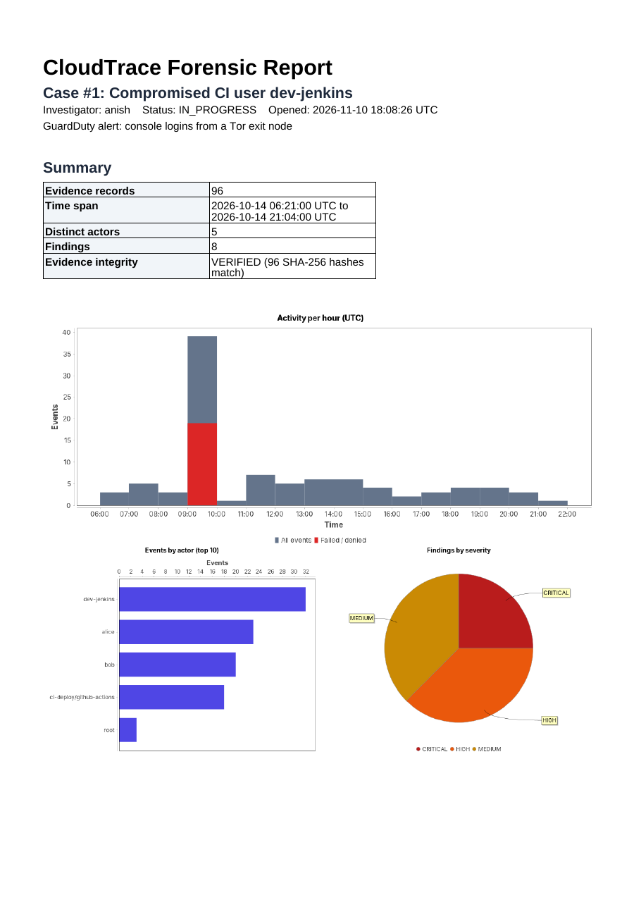
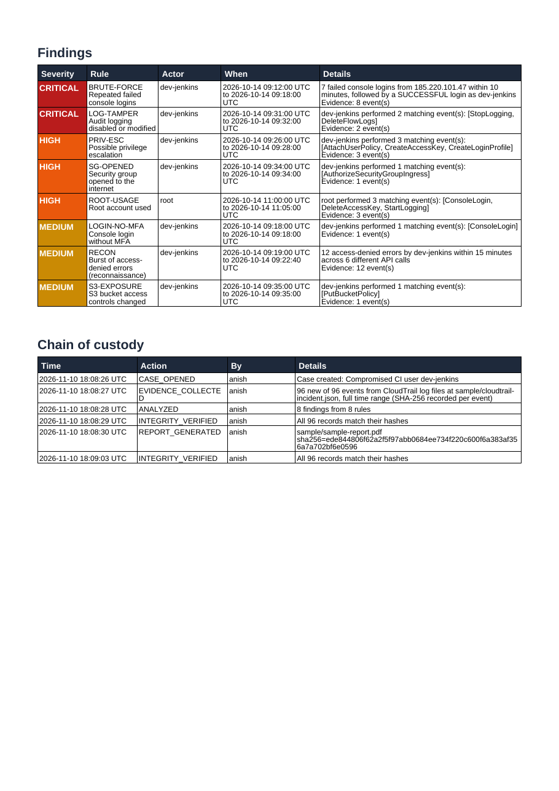

# CloudTrace: Cloud Forensic Investigation Framework

CloudTrace is an object-oriented Java application for investigating security incidents in AWS. It collects CloudTrail logs as **evidence** (using the AWS SDK for Java or exported log files), fingerprints every record with **SHA-256**, stores cases and evidence in **MySQL**, detects attacker behaviour with a set of forensic rules, keeps a **chain of custody**, and produces a **PDF report with JFreeChart charts**. It is tested with **JUnit 5**.


| Report summary and charts | Findings and chain of custody |
| --- | --- |
|  |  |

The full sample report is in [`sample/sample-report.pdf`](sample/sample-report.pdf).

## Features

- **Evidence collection** from the CloudTrail `LookupEvents` API (AWS SDK v2, paginated, filter by user) or from CloudTrail log files (`.json` / `.json.gz`, single file or whole folder exported from S3)
- **Integrity**: every original record is stored verbatim and hashed with SHA-256 at collection; `verify` re-hashes everything and names any altered record
- **Chain of custody**: every action (case opened, evidence collected, analysis, verification, report generated with its own hash, case closed) is logged with who and when
- **8 detection rules** covering common attack stages:

  | Rule | Severity | Detects |
  | --- | --- | --- |
  | BRUTE-FORCE | High, or Critical if a login then succeeds | 5+ failed console logins from one IP within 10 minutes |
  | LOG-TAMPER | Critical | StopLogging, DeleteTrail, DeleteFlowLogs, disabling GuardDuty / Config / Security Hub |
  | PRIV-ESC | High | Attaching admin policies, inline policies, creating keys or passwords for other users |
  | SG-OPENED | High | Security group rules opened to 0.0.0.0/0 or ::/0 |
  | ROOT-USAGE | High | Any successful action by the root user |
  | LOGIN-NO-MFA | Medium | Successful console login without MFA |
  | RECON | Medium | 10+ access-denied errors by one identity within 15 minutes |
  | S3-EXPOSURE | Medium | Bucket ACL, policy, public access block or encryption changes |

- **MySQL** schema for cases, evidence, findings and custody, with SQL aggregation for the report
- **PDF reports** (OpenPDF) with an activity timeline, events-by-actor and findings-by-severity charts (JFreeChart), a findings table, the chain of custody and an evidence appendix with hashes
- **Case lifecycle**: OPEN → IN_PROGRESS → CLOSED; closed cases reject new evidence

## Design

```
                    ┌──────────────── EvidenceCollector (interface) ───────────────┐
                    │  CloudTrailApiCollector (AWS SDK)   CloudTrailFileCollector  │
                    └────────────────────────────┬─────────────────────────────────┘
                                                 ▼
 Main (CLI) ──► InvestigationService ──► CaseRepository (JDBC) ──► MySQL
                    │          │
                    │          └──► Analyzer ──► DetectionRule (interface)
                    │                              ├─ EventMatchRule (abstract): ROOT-USAGE, LOG-TAMPER, PRIV-ESC, ...
                    │                              └─ BurstRule (abstract, sliding window): BRUTE-FORCE, RECON
                    └──► PdfReportGenerator ──► Charts (JFreeChart)
```

New detections are added by extending `EventMatchRule` (single events) or `BurstRule` (N events in a time window) and registering them in `Rules.all()`.

## Quick start

Requirements: Java 17+, Maven, and MySQL 8 (or Docker).

```bash
docker compose up -d mysql
mvn package
export CLOUDTRACE_DB_URL="jdbc:mysql://localhost:3306/cloudtrace?serverTimezone=UTC"
export CLOUDTRACE_DB_USER=cloudtrace CLOUDTRACE_DB_PASSWORD=cloudtrace

java -jar target/cloudtrace.jar case-open --title "Compromised CI user" --investigator anish
java -jar target/cloudtrace.jar import  --case 1 --path sample/cloudtrail-incident.json
java -jar target/cloudtrace.jar analyze --case 1
java -jar target/cloudtrace.jar verify  --case 1
java -jar target/cloudtrace.jar report  --case 1 --out case1.pdf
java -jar target/cloudtrace.jar close   --case 1
```

To collect live from AWS instead of a file (uses your normal AWS credentials; needs `cloudtrail:LookupEvents`):

```bash
java -jar target/cloudtrace.jar collect --case 1 --hours 48 --region us-east-1 [--user dev-jenkins]
```

## The sample incident

[`sample/cloudtrail-incident.json`](sample/cloudtrail-incident.json) is a fictional account compromise in the real CloudTrail format, generated by [`sample/generate_sample.py`](sample/generate_sample.py). An attacker brute-forces the `dev-jenkins` console login from a Tor exit node, probes IAM, Secrets Manager and KMS, grants itself AdministratorAccess, creates a backdoor key for another user, stops CloudTrail, opens SSH to the internet and changes an S3 bucket policy. CloudTrace finds every stage, and also flags the responder's use of the root account.

## Tests

```bash
mvn test                                     # JUnit 5, using H2 in MySQL mode
CLOUDTRACE_TEST_MYSQL_URL="jdbc:mysql://localhost:3306/cloudtrace_test?serverTimezone=UTC" \
CLOUDTRACE_TEST_MYSQL_USER=root CLOUDTRACE_TEST_MYSQL_PASSWORD=root mvn test   # also against real MySQL
```

33 tests cover log parsing, hashing, the AWS SDK collector (Mockito-mocked client and pagination), every detection rule, the repository on H2 and MySQL, tamper detection, the case lifecycle, PDF content, and the CLI end to end. GitHub Actions runs them against a MySQL 8.4 service container, builds the jar, generates the sample report and publishes the JaCoCo coverage report.

## Project layout

```
src/main/java/com/cloudtrace/
  model/      InvestigationCase, Evidence, Finding, CustodyEntry, Severity
  collect/    EvidenceCollector, CloudTrailApiCollector, CloudTrailFileCollector, parser, hashing
  analysis/   DetectionRule, EventMatchRule, Rules, Analyzer
  store/      Database, CaseRepository (JDBC)
  service/    InvestigationService, IntegrityReport
  report/     PdfReportGenerator, Charts
  cli/        Main
src/main/resources/schema.sql   MySQL schema
sample/                          sample incident logs and report
```
